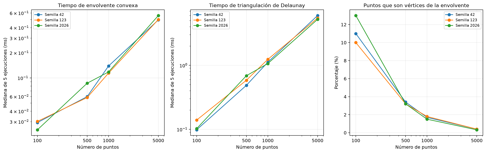
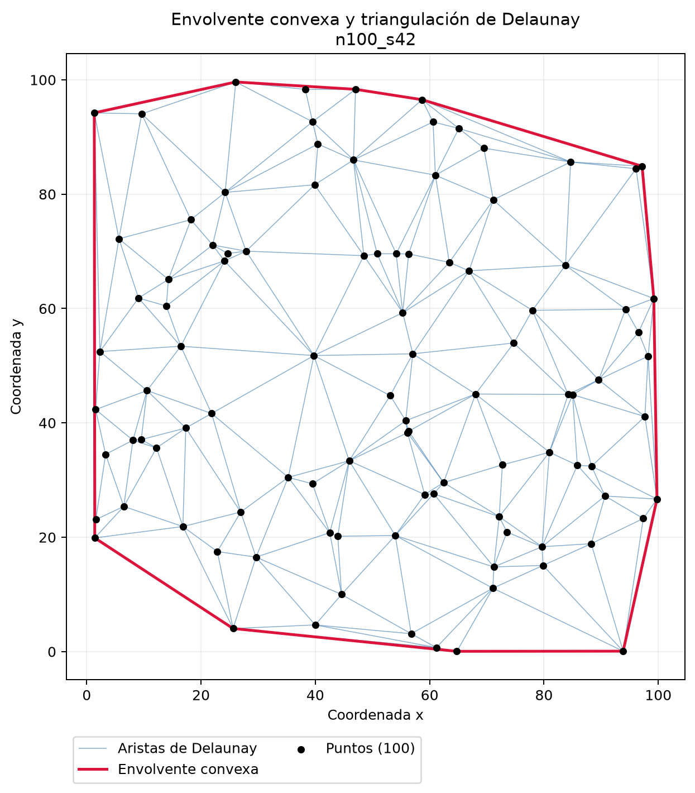
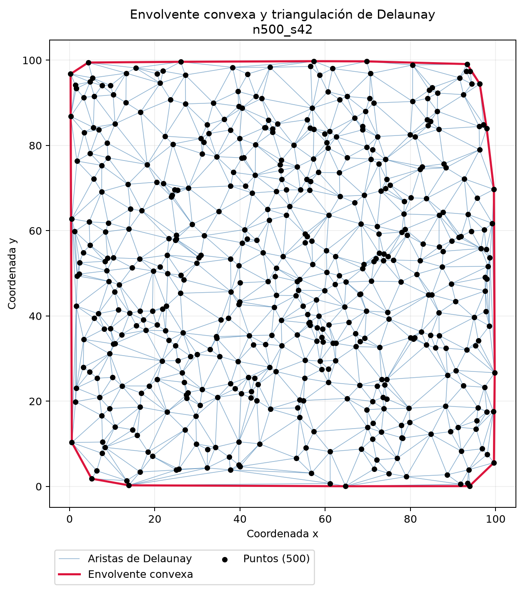
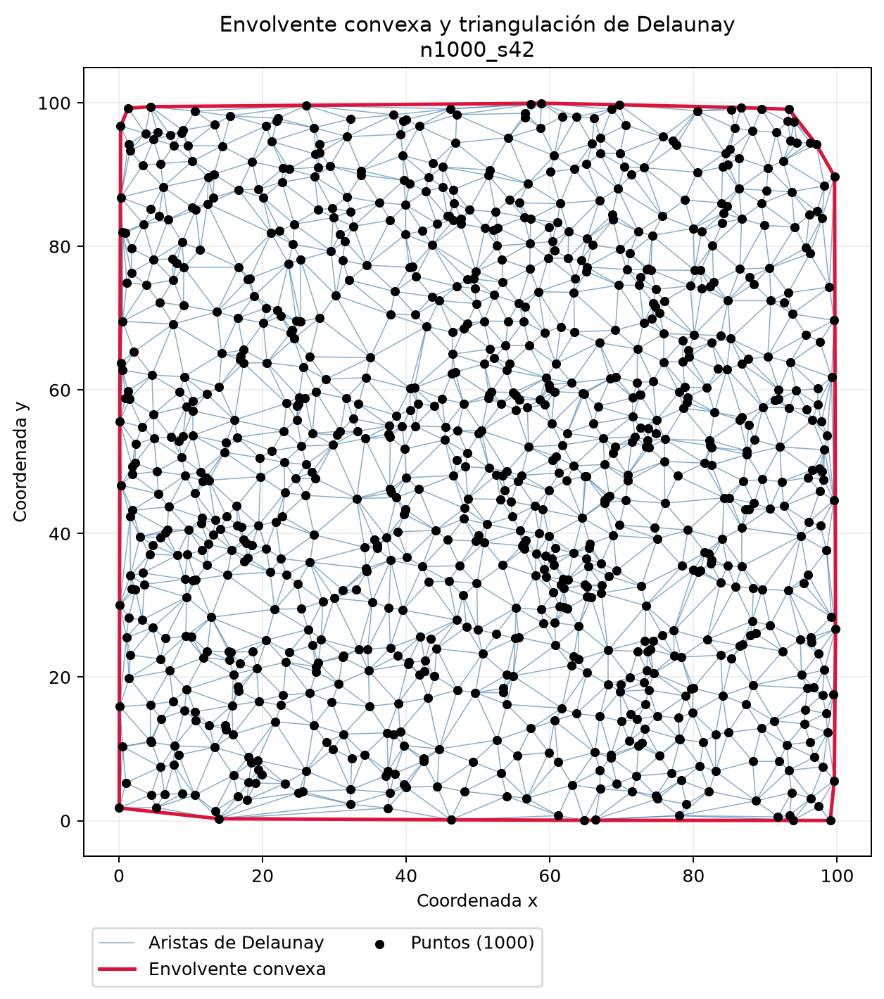
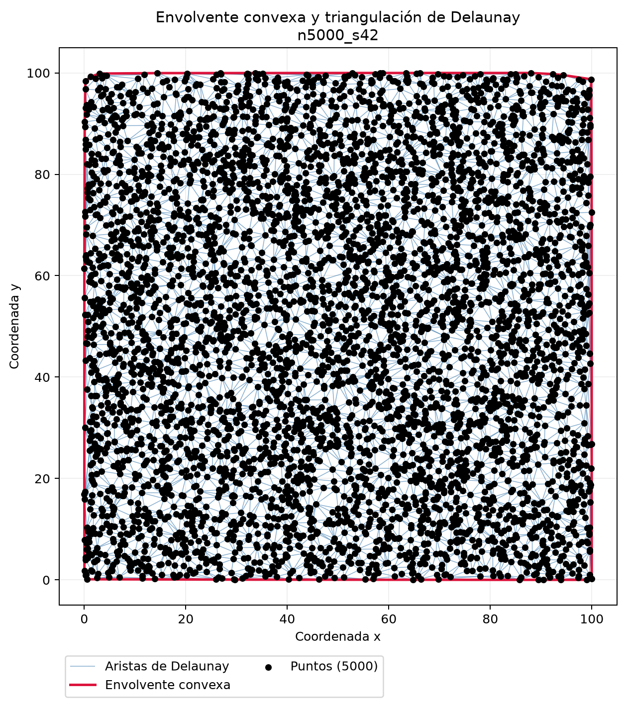
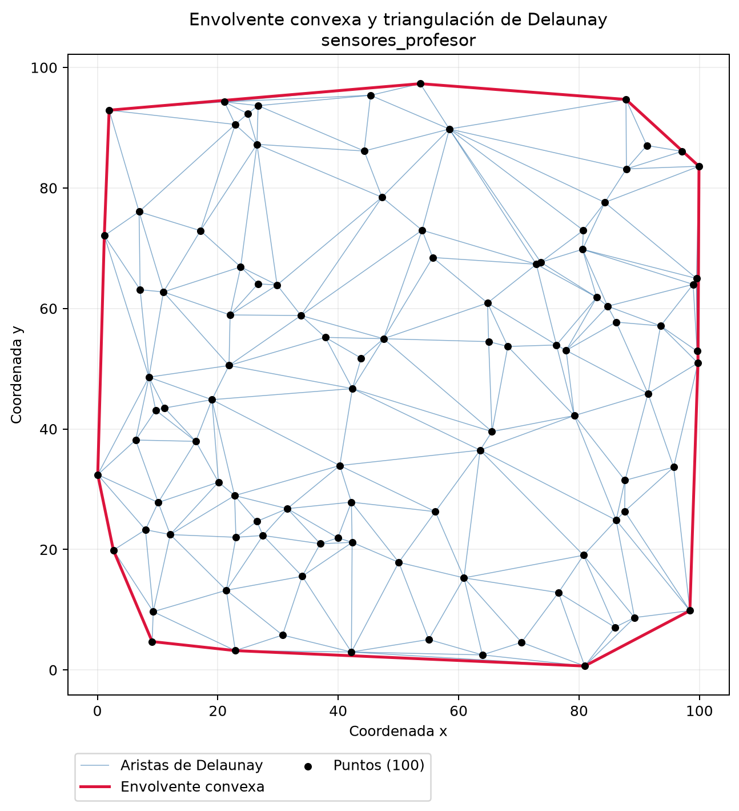

# Resultados experimentales

Autores: Jimmy Alexander Calderón Trujillo y Sebastián Barahona.

## Método

Se generaron nubes uniformes en [0,100) x [0,100), con tamaños
100, 500, 1000 y 5000 y semillas 42, 123 y 2026.
Para cada combinación se realizó una ejecución previa y cinco
ejecuciones registradas, cada una en un proceso independiente.

Se midieron por separado la envolvente y Delaunay con steady_clock.
Los intervalos excluyen generación de puntos, validación, exportación,
arranque del proceso y visualización.

La ejecución previa puede reducir efectos de carga del sistema,
pero no mantiene calientes las estructuras internas de otro proceso.
Los resultados representan estas condiciones concretas de ejecución.

## Tabla de mediciones

Los tiempos son medianas de cinco ejecuciones, en milisegundos.
H es el número de vértices extremos de la envolvente.

| n | Semilla | H | H/n (%) | V | E finitas | F finitas | Envolvente (ms) | Delaunay (ms) |
|---:|---:|---:|---:|---:|---:|---:|---:|---:|
| 100 | 42 | 11 | 11.00 | 100 | 286 | 187 | 0.029242 | 0.098358 |
| 100 | 123 | 10 | 10.00 | 100 | 287 | 188 | 0.030158 | 0.139517 |
| 100 | 2026 | 13 | 13.00 | 100 | 284 | 185 | 0.023925 | 0.102575 |
| 500 | 42 | 17 | 3.40 | 500 | 1480 | 981 | 0.059767 | 0.486842 |
| 500 | 123 | 16 | 3.20 | 500 | 1481 | 982 | 0.058300 | 0.584375 |
| 500 | 2026 | 16 | 3.20 | 500 | 1481 | 982 | 0.086442 | 0.688233 |
| 1000 | 42 | 17 | 1.70 | 1000 | 2980 | 1981 | 0.139241 | 1.118059 |
| 1000 | 123 | 18 | 1.80 | 1000 | 2979 | 1980 | 0.114400 | 1.239333 |
| 1000 | 2026 | 15 | 1.50 | 1000 | 2982 | 1983 | 0.118159 | 1.064800 |
| 5000 | 42 | 20 | 0.40 | 5000 | 14977 | 9978 | 0.495092 | 5.985650 |
| 5000 | 123 | 20 | 0.40 | 5000 | 14977 | 9978 | 0.500317 | 5.459392 |
| 5000 | 2026 | 16 | 0.32 | 5000 | 14981 | 9982 | 0.558983 | 5.217667 |

## Respuestas al análisis de resultados

### 1. Proporción de puntos en la frontera

En estas nubes, los vértices extremos representaron entre 10 y 13 %
para 100 puntos y entre 0.32 y 0.40 % para 5000 puntos.
La mayoría de los nuevos puntos queda en el interior.

Esta observación corresponde al dominio y distribución ensayados.
No es una regla universal: si todos los puntos están en posición
convexa, todos pueden pertenecer a la envolvente.

### 2. Información que no conserva la envolvente

La envolvente describe el contorno convexo mediante sus extremos.
No registra conexiones entre puntos interiores, sus distancias
ni la estructura local de la nube.

### 3. Información adicional de Delaunay

Delaunay incorpora los puntos distintos como vértices y aporta
aristas, triángulos y relaciones de adyacencia.
Permite estudiar la estructura espacial interior, aunque no
demuestra conexiones físicas entre sensores.

### 4. Conteos y relaciones de Euler

La tabla presenta los conteos de cada nube.
Las 60 ejecuciones pasaron la comprobación V-E+F=1 y dt.is_valid().
La cara exterior se excluyó de F.

### 5. Tiempos de ejecución

Para cada semilla, las medianas aumentaron con los tamaños
ensayados. Delaunay requirió más tiempo que la envolvente.

Influyen la distribución de puntos, la carga del sistema,
la frecuencia del procesador, las cachés, el asignador de memoria,
el compilador y las operaciones geométricas necesarias.

La mediana reduce la influencia de valores aislados, pero cinco
repeticiones y cuatro tamaños no demuestran una complejidad asintótica.
Las mediciones individuales se conservan en datos/cgal/mediciones.csv.

### 6. Configuraciones degeneradas

| Caso | Entradas | V distintos | H | E | F | Dimensión |
|---|---:|---:|---:|---:|---:|---:|
| Repetidos | 8 | 5 | 4 | 8 | 4 | 2 |
| Colineales | 5 | 5 | 2 | 4 | 0 | 1 |
| Cocirculares | 4 | 4 | 4 | 5 | 2 | 2 |

Los duplicados no generan nuevos vértices.
Los colineales producen una envolvente segmentaria y ninguna cara
triangular. En el cuadrado cocircular cualquiera de sus dos
diagonales produce una triangulación de Delaunay válida.

El ensayo cocircular comprobó los conteos y la validez de la solución
obtenida; no ejecutó una comparación entre ambas diagonales.

### 7. Semillas y reproducibilidad

Con la misma semilla y tamaño, los archivos de puntos, envolvente
y aristas conservaron la misma huella SHA-256 en las repeticiones.
Los tiempos variaron aunque la geometría se mantuvo.

Con semillas distintas cambiaron las posiciones y los conteos
de vértices extremos. La comprobación de reproducibilidad se limita
al mismo entorno, ejecutable y bibliotecas; no garantiza archivos
idénticos entre todas las plataformas o versiones.

## Datos suministrados por el profesor

El CSV contiene 100 sensores con identificadores y coordenadas
x_m e y_m en metros. Se conservó el archivo original y se comprobó
que los identificadores y posiciones no estuvieran repetidos.

Se obtuvieron 12 vértices extremos, 285 aristas y 186 caras finitas,
con 100 vértices distintos y triangulación válida.

El tiempo registrado corresponde a una sola ejecución de este caso,
por lo que no se compara estadísticamente con las medianas de las
nubes aleatorias. No se afirma que sean posiciones medidas en campo:
son datos suministrados por el profesor.

## Figuras

## Conclusión

La envolvente resume la extensión convexa y Delaunay describe
la conectividad geométrica interior. Los ensayos muestran la
importancia de verificar conteos, degeneraciones y representación
numérica además de medir tiempos.
