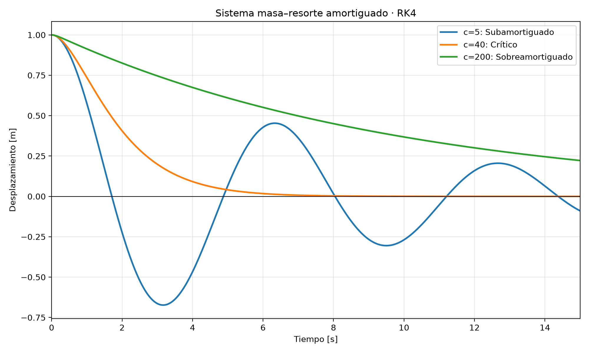

# Sistema masa–resorte amortiguado

## Problema

Resolver $mx''+cx'+kx=0$ con m=20 kg, k=20 N/m y
c=5, 40 y 200 N·s/m. Condiciones iniciales: x(0)=1 m y v(0)=0 m/s.
Se calcula desde 0 hasta 15 s, incluyendo los extremos.

## Desarrollo y método

Definiendo v=x', se transforma la ecuación de segundo orden:

$$x'=v,\qquad v'=-x-\frac{c}{20}v.$$

Para el estado Y=[x,v], la función F(Y)=[v,-x-(c/20)v].
Se implementa Runge–Kutta clásico de cuarto orden directamente:

$$K_1=F(Y_n),\qquad K_2=F(Y_n+hK_1/2),$$
$$K_3=F(Y_n+hK_2/2),\qquad K_4=F(Y_n+hK_3),$$
$$Y_{n+1}=Y_n+\frac{h}{6}(K_1+2K_2+2K_3+K_4).$$

Se utiliza h=0.01 s: 1500 pasos y 1501 estados.
El sistema es autónomo, por lo que F no depende explícitamente del tiempo.
El error global de RK4 es de orden cuatro para soluciones suaves y pasos estables.
Se comprueba el resultado frente a la solución exacta y con h=0.005 s.

## Clasificación del amortiguamiento

$$c_{cr}=2\sqrt{mk}=40\ \mathrm{N\,s/m}.$$

| c (N·s/m) | c/c_cr | Tipo |
|---:|---:|---|
| 5 | 0.125 | Subamortiguado |
| 40 | 1 | Crítico |
| 200 | 5 | Sobreamortiguado |

## Gráfica



## Resultados

| t (s) | x con c=5 (m) | x con c=40 (m) | x con c=200 (m) |
|---:|---:|---:|---:|
| 0 | 1.00000000 | 1.00000000 | 1.00000000 |
| 1 | 0.57570896 | 0.73575888 | 0.91323366 |
| 2 | -0.22309800 | 0.40600585 | 0.82548560 |
| 5 | 0.06622624 | 0.04042768 | 0.60966540 |
| 10 | -0.26907497 | 0.00049940 | 0.36789873 |
| 15 | -0.08979095 | 0.00000489 | 0.22200616 |

## Validación analítica

Para c=5, a=0.125 y w=sqrt(1-a²):

$$x(t)=e^{-at}[\cos(wt)+(a/w)\sin(wt)].$$

Para c=40:

$$x(t)=(1+t)e^{-t}.$$

Para c=200, r_1=-5+sqrt(24) y r_2=-5-sqrt(24):

$$x(t)=\frac{-r_2e^{r_1t}+r_1e^{r_2t}}{r_1-r_2}.$$

Estas expresiones satisfacen las condiciones iniciales.
La tabla muestra el máximo error absoluto del desplazamiento sobre cada malla.

| c (N·s/m) | Error con h=0.01 (m) | Error con h=0.005 (m) |
|---:|---:|---:|
| 5 | 2.467763e-10 | 1.541531e-11 |
| 40 | 9.701706e-11 | 6.030954e-12 |
| 200 | 3.296138e-09 | 1.976700e-10 |

## Conclusiones

1. Con c=5 se presentan oscilaciones de amplitud decreciente. Los valores
   negativos indican que la masa cruza la posición de equilibrio.
2. Con c=40 el retorno no oscila y es más rápido que con c=200 para estas
   condiciones iniciales. Un amortiguamiento mayor no garantiza un retorno
   más rápido: el caso sobreamortiguado conserva un desplazamiento importante
   al terminar los 15 segundos.
3. RK4 calcula desplazamiento y velocidad simultáneamente. La solución exacta
   y la reducción del paso permiten verificar la precisión numérica.

## Reproducción

Desde la raíz del repositorio, con NumPy y Matplotlib instalados:

```bash
python Python/masa_resorte/masa_resorte_rk4.py
```

Se generan tres CSV en datos/masa_resorte, con tiempo, desplazamiento,
velocidad, posición exacta y error absoluto. La gráfica y este informe
se regeneran en Informe/masa_resorte.

## Fuente

Enunciado del sistema masa–resorte suministrado por el profesor.
